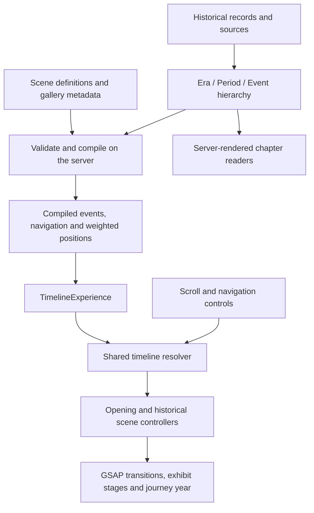

<div align="center">

# History of India

**An interactive journey through Indian history, brought to life through scrolling, visual evidence and stories.**

From prehistoric landscapes to independent India in **2025**.


[Get started](#get-started) · [Historical coverage](#historical-coverage) · [Folder structure](#project-structure) · [Add content](#content-and-media-workflow) · [Documentation](#documentation)

</div>

---

## About the project

History of India is an educational website built around one continuous timeline. Scrolling moves
through a cinematic opening, historical exhibits, images and source-backed explanations. Visitors
can also jump between events, search the collection or read the evidence independently.

The current collection contains **252 entries across eight populated chapters**, with **57 distinct
gallery image files** and tagged spaces for missing images or research. Historical content,
presentation and animation are maintained separately so the project can grow without placing
historical facts inside UI or animation code.

> **Scope:** Indian history through **2025**. This is an expanding, sourced overview rather than an
> exhaustive account. Regional overlap, approximate dates and interpretation limits remain explicit.
> The final entry is the 2025 UNESCO inscription of the Maratha Military Landscapes. Research review
> dates may be later than 2025; they describe editorial work, not additional timeline events.

## The experience

| Feature                     | What visitors can do                                                                                                |
| --------------------------- | ------------------------------------------------------------------------------------------------------------------- |
| **Cinematic opening**       | Enter through reversible typography, imagery and deep-time visuals.                                                 |
| **Scroll through time**     | Watch the journey year change in both directions, with weighted scene durations and reversible transitions.         |
| **Interactive exhibits**    | Select explanatory stages, examine diagrams and open images with contextual captions.                               |
| **Direct navigation**       | Jump by era, period or event, or move one event at a time.                                                          |
| **Search and filters**      | Search people, places and detail text; combine era, period, community and century filters through the 21st century. |
| **Evidence and sources**    | Read background, consequences, citations, interpretation notes and related events.                                  |
| **Shareable events**        | Link to a stable event with a fragment such as `#event=republic-chandrayaan-3`.                                     |
| **Accessible alternatives** | Use keyboard controls, reduced-motion behaviour and server-rendered readers for all eight chapters.                 |

The animated journey requires JavaScript. The chapter readers retain historical text and sources
when JavaScript is disabled.

## Historical coverage

Events are globally sorted by their start dates. Chapters are editorial groupings, so regional
histories and long-running developments can overlap.

| Chapter                               | Entries | Coverage and guide                                                                                                  |
| ------------------------------------- | ------: | ------------------------------------------------------------------------------------------------------------------- |
| **Prehistoric India**                 |      24 | Palaeolithic traditions, Mesolithic communities, farming and settlement. [Guide](docs/prehistoric-content.md)       |
| **Ancient India & Early Transitions** |      15 | Harappan urbanism, material culture and early intellectual transitions. [Guide](docs/ancient-india-content.md)      |
| **Second Urbanization & Empires**     |      17 | Cities, religious traditions, states and Mauryan history. [Guide](docs/second-urbanization-content.md)              |
| **Classical & Medieval India**        |      22 | Regional kingdoms, learning, devotion, art and architecture. [Guide](docs/classical-medieval-content.md)            |
| **Early Modern India**                |      54 | Courts, maritime connections, regional powers and economic change. [Guide](docs/early-modern-india-content.md)      |
| **Colonial Era & British Rule**       |      36 | Company expansion, colonial institutions, resistance and transfer of power. [Guide](docs/colonial-india-content.md) |
| **Indian Independence Movement**      |      29 | Organisations, campaigns, political ideas and struggles for freedom. [Guide](docs/independence-movement-content.md) |
| **Post-Independence to 2025**         |      55 | The republic, democracy, society, development, rights and science. [Guide](docs/post-independence-content.md)       |
| **Total**                             | **252** | **Eight populated chapters**                                                                                        |

The existing 1947 independence and Partition milestone is shared through the timeline; the
post-independence chapter continues from 1948.

## Get started

### Requirements

- **Node.js 20.9 or newer** and npm. Browser regression checks require **Node.js 22+**.
- A local checkout of this repository.
- Chrome or Chromium only for the optional browser checks.

No API keys, database, account setup or environment variables are required for the current app.

### Run locally

Open a terminal in the repository root. For the existing Windows workspace:

```powershell
Set-Location "D:\Indian History"
npm ci
npm run dev
```

For another checkout, use its folder instead. `npm ci` installs the versions recorded in
`package-lock.json`; run it on initial setup or after dependency changes.

Open the **Local URL printed by Next.js**. It is commonly `http://localhost:3000`, but the port may
change if another process is using it. Stop the server with **Ctrl+C**.

### Explore the website

1. Scroll through the opening or use its start control to enter the timeline.
2. Scroll forward or backward to change the active event and journey year.
3. Use chapter tabs, period/event selectors or previous/next buttons to jump directly.
4. Select an exhibit stage, then open its gallery or **Evidence & sources** for more detail.
5. Use **Explore chapter** to search, combine filters or follow the chapter reader link.

Standard keyboard scrolling and **Tab**, **Enter** and **Escape** work with the page and dialogs.
The site respects the operating system's reduced-motion setting.

### Preview production

```powershell
npm run build
npm run start
```

To use a specific port after building:

```powershell
node node_modules/next/dist/bin/next start -p 3121
```

## Commands

Run commands from the repository root.

| Command                                         | Purpose                                                                        |
| ----------------------------------------------- | ------------------------------------------------------------------------------ |
| `npm run dev`                                   | Start the development server.                                                  |
| `npm run dev:fresh`                             | Clear generated development output safely and restart development.             |
| `npm run build`                                 | Compile and prerender the production app.                                      |
| `npm run start`                                 | Serve an existing production build.                                            |
| `npm run lint`                                  | Run ESLint.                                                                    |
| `npm run typecheck`                             | Check TypeScript without emitting application files.                           |
| `npm run format`                                | Format supported files with Prettier; this modifies files.                     |
| `npm run format:check`                          | Check formatting without changing files.                                       |
| `npm run test`                                  | Run Node.js content and timeline regression tests.                             |
| `npm run validate:content`                      | Compile content and audit references, local assets and editorial warnings.     |
| `npm run check`                                 | Run lint, type checking, formatting, tests and content validation in sequence. |
| `npm run test:browser -- http://localhost:3121` | Check an already-running site in headless Chrome/Chromium; use its actual URL. |

Use `npm run validate:content -- --strict` to treat warnings as failures. It currently fails on
four existing prehistoric media-credit warnings until those records are completed.

## Technology

| Layer              | Implementation                                                                     |
| ------------------ | ---------------------------------------------------------------------------------- |
| Framework          | Next.js 16.3, App Router, React 19                                                 |
| Language           | TypeScript with `strict` and `noUncheckedIndexedAccess`                            |
| Styling            | Tailwind CSS 4 and domain-specific CSS                                             |
| Motion             | GSAP 3 and ScrollTrigger                                                           |
| Historical content | Typed local TypeScript records and bibliographies                                  |
| Visuals            | React-rendered SVG diagrams and local image galleries                              |
| Quality tools      | ESLint 9, Prettier, TypeScript, Node.js tests and a Chrome DevTools browser script |

There is currently no database, CMS, authentication system or application API. MDX, D3, Three.js
and MapLibre are not installed. Reserved folders do not imply those features are implemented.
Dependency ranges are in [package.json](package.json); resolved versions are in
[package-lock.json](package-lock.json).

## Architecture and data flow



[src/app/page.tsx](src/app/page.tsx) calls [compileHistory](src/lib/content/compile.ts) before
rendering. Compilation validates the hierarchy, sorts events, connects presentations and generates
weighted timeline positions from scene durations. Invalid IDs, references and ranges fail early.

[TimelineExperience](src/components/timeline/timeline-experience.tsx) owns the interactive experience.
One ScrollTrigger partitions the journey between the opening and historical scenes. Navigation
uses the same positions as scrolling; scene controllers apply reversible transitions. Continuous
animation updates do not require React to render every frame.

Dates distinguish **BCE/CE calendar years** from **years ago**. Calendar years are positive and have
no year zero. Approximation and date scope remain explicit. The moving year is an interpolated
navigation aid; each event retains its own published date or range. Deep-time sorting uses a
synthetic ordinal rather than a scientific BP reference epoch.

## Project structure

### Repository map

```text
Indian History/
├── src/
│   ├── app/                       # App Router entry points and styles
│   │   ├── layout.tsx             # HTML shell, metadata and style imports
│   │   ├── page.tsx               # Server compilation and chapter composition
│   │   ├── globals.css            # Global layout and timeline styles
│   │   ├── prehistory.css         # Shared exhibit, reader and gallery styles
│   │   └── opening-polish.css     # Opening presentation
│   ├── animations/
│   │   ├── opening/               # Cinematic controller and frame transitions
│   │   ├── scenes/                # Scene controller and transition strategies
│   │   ├── timeline/              # ScrollTrigger setup, navigation and cleanup
│   │   └── visual-scenes/         # Reserved scaffold
│   ├── components/
│   │   ├── historical-events/     # Event content, details, readers and gap tags
│   │   ├── opening/               # Cinematic text, visuals, progress and stages
│   │   ├── timeline/              # Experience, navigation, explorer and rail
│   │   ├── visual-scenes/         # Layers, diagrams, exhibits and galleries
│   │   ├── maps/                  # Reserved map-component scaffold
│   │   └── site/                  # Empty local scaffold
│   ├── content/
│   │   ├── eras/                  # Reserved long-form narrative scaffold
│   │   └── events/                # Reserved long-form narrative scaffold
│   ├── data/                      # Historical records and scene definitions
│   ├── lib/
│   │   ├── content/
│   │   │   ├── compile.ts         # Validated, serializable UI model
│   │   │   └── validate.ts        # Historical schema and reference checks
│   │   ├── historical-date.ts     # Date creation, sorting and formatting
│   │   ├── history-explorer.ts    # Search, filters and related events
│   │   ├── timeline.ts            # Flattened hierarchy and navigation
│   │   └── timeline-position.ts   # Weighted progress and inverse navigation
│   └── types/                     # History, dates, scenes, opening and UI types
├── public/assets/                 # Static media served directly by Next.js
├── docs/                          # Guides, inventories and media manifests
├── scripts/                       # Checks, recovery and maintenance tools
├── tests/                         # Content and timeline regression tests
├── AGENTS.md                      # Repository guidance for coding agents
├── package.json                   # Scripts, dependencies and Node requirement
├── package-lock.json              # Reproducible dependency resolution
├── next.config.ts                 # Next.js configuration
├── tsconfig.json                  # Strict TS settings; @/* maps to src/*
├── eslint.config.mjs              # Lint rules
├── postcss.config.mjs             # Tailwind/PostCSS integration
├── .prettierrc.json                # Formatting rules
├── .prettierignore                 # Formatting exclusions
├── .editorconfig                  # Editor conventions
├── .gitignore                     # Generated/local file exclusions
└── README.md                      # Project guide
```

Some empty local folders may disappear in a fresh Git checkout; `.gitkeep` files preserve tracked
scaffolding. Existing `prehistory-*` component names also serve later chapters.

<details>
<summary><strong>Expand: historical data and presentation files</strong></summary>

```text
src/data/
├── opening/
│   └── opening-sequence.ts        # Copy, beats, timing and media metadata
├── timeline/
│   ├── indian-history.ts          # Canonical registry of all eight eras
│   ├── timeline-presentation.ts   # Event-to-presentation projection
│   ├── prehistoric-india.ts       # Periods and original lower-Palaeolithic record
│   ├── ancient-india.ts
│   ├── second-urbanization.ts
│   ├── classical-medieval.ts
│   ├── early-modern-india.ts
│   ├── colonial-india.ts
│   ├── independence-india.ts
│   ├── post-independence-india.ts
│   ├── prehistory/                # Events, sources, gaps, regional expansion
│   ├── ancient/                   # Events, evidence notes and bibliography
│   ├── empires/                   # Events, details, sources and image needs
│   ├── classical/                 # Records, event builder and sources
│   ├── early-modern/              # Records, event builder and sources
│   ├── colonial/                  # Records, event builder and sources
│   ├── independence/              # Records with sources, plus event builder
│   ├── post-independence/         # Records with sources, plus event builder
│   └── world/                     # Empty scaffold; no world-history chapter
├── scenes/
│   ├── scene-presentations.ts     # Shared presentation registry
│   ├── default-scene.ts           # Fallback for events without custom visuals
│   ├── prehistoric-scenes.ts      # Prehistoric scene composition
│   ├── prehistory-exhibits.ts     # Diagrams and exhibit definitions
│   ├── palaeolithic-gallery.ts    # Palaeolithic image metadata
│   ├── ancient-exhibits.ts        # Ancient scene presentation
│   ├── ancient-galleries.ts       # Researched ancient images and attribution
│   ├── empire-exhibits.ts         # Empire exhibits and galleries
│   ├── classical-exhibits.ts
│   ├── classical-galleries.ts
│   ├── early-modern-exhibits.ts
│   ├── early-modern-galleries.ts
│   ├── colonial-exhibits.ts
│   ├── colonial-galleries.ts
│   ├── independence-exhibits.ts
│   ├── independence-galleries.ts
│   ├── post-independence-exhibits.ts
│   ├── post-independence-galleries.ts
│   └── prototype-scenes.ts        # Retained prototype/presentation definitions
├── historical-events/             # Reserved; active records live in timeline/
└── maps/                          # Reserved structured map-data scaffold
```

Keep facts and citations in `timeline/`; place palettes, diagrams, stage images and transitions
in `scenes/`. Source organisation varies by chapter, so consult its guide before editing.

</details>

<details>
<summary><strong>Expand: static assets and generated folders</strong></summary>

```text
public/assets/
├── images/
│   ├── opening/                  # Current opening image assets
│   ├── prehistoric_india/
│   │   ├── lower_palaeolithic_india/
│   │   └── middle_palaeolithic_india/
│   ├── ancient_india/
│   ├── empires/
│   ├── classical/
│   ├── early-modern/
│   ├── colonial/
│   ├── independence/
│   ├── post-independence/
│   └── world/                    # Empty local scaffold, unused
├── illustrations/                # Reserved asset scaffold
├── maps/                         # Reserved asset scaffold
└── models/                       # Reserved scaffold; no 3D runtime
```

An image at `public/assets/images/post-independence/raigad-2018.jpg` is served as
`/assets/images/post-independence/raigad-2018.jpg`. Public URLs exclude the `public` directory.

| Generated/local path   | Purpose                                                    |
| ---------------------- | ---------------------------------------------------------- |
| `node_modules/`        | Installed dependencies; regenerate with `npm ci`.          |
| `.next/`               | Next.js development and production output.                 |
| `.browser-artifacts/`  | Screenshots from browser regression runs.                  |
| `next-env.d.ts`        | Next.js-generated type declarations.                       |
| `*.tsbuildinfo`        | TypeScript incremental cache.                              |
| Local logs and `.env*` | Local diagnostics or future configuration; ignored by Git. |

Do not commit generated output. There is no required `.env` file. Earlier design notes describe
possible opening audio/video folders; current opening images live in `public/assets/images/opening/`.

</details>

## Quality checks

```powershell
npm run check
npm run build
```

The current suite contains **35 tests** covering validation, date boundaries, chronology, weighted
navigation, filters, citations, relationships and local media. Content validation currently reports
**four existing Lower Palaeolithic media-credit warnings**; successful validation is not a blanket
rights clearance for every image.

### Browser verification

Start the production server in one terminal. In a second terminal:

```powershell
npm run test:browser -- http://localhost:3121
```

Use the actual running URL. The script requires **Node.js 22+** and Chrome/Chromium. On Windows it
defaults to `C:\Program Files\Google\Chrome\Application\chrome.exe`. If your executable is elsewhere:

```powershell
$env:CHROME_PATH = "C:\Path\To\Chrome\chrome.exe"
npm run test:browser -- http://localhost:3121
```

It checks exhibits at **1440px, 768px and 390px**, images, evidence tags, filters, dialogs, focus,
shared links, chapter transitions, reverse scrolling, reduced motion, hydration/runtime errors and
all eight readers without JavaScript. Screenshots go to `.browser-artifacts/`. A full pass takes
several minutes and does not replace physical-device or other-browser testing.

## Maintenance scripts

These are developer tools. **None runs automatically when a visitor opens the website.**

| File                                                                 | Purpose                                                                      |
| -------------------------------------------------------------------- | ---------------------------------------------------------------------------- |
| [validate-content.cjs](scripts/validate-content.cjs)                 | Compiles content, checks local scene/gallery assets and prints warnings.     |
| [browser-smoke.cjs](scripts/browser-smoke.cjs)                       | Exercises a running site in headless Chrome and saves screenshots.           |
| [dev-fresh.cjs](scripts/dev-fresh.cjs)                               | Clears only `.next/dev` after lock/path checks, then starts development.     |
| [register-typescript.cjs](scripts/register-typescript.cjs)           | Loads TypeScript and the `@/` alias for Node tools; not a standalone task.   |
| [fetch-classical-media.cjs](scripts/fetch-classical-media.cjs)       | Downloads two selected Met public-domain images and updates their manifest.  |
| [fetch-early-modern-media.cjs](scripts/fetch-early-modern-media.cjs) | Downloads five selected Met public-domain images and updates their manifest. |
| [fetch-colonial-media.cjs](scripts/fetch-colonial-media.cjs)         | Downloads two selected Met public-domain images and updates their manifest.  |

The downloaders require network access and currently call **`curl.exe`**, so their implementation
is Windows-specific. They can overwrite selected images and manifests. They are optional
maintenance commands, not installation prerequisites:

```powershell
node scripts/fetch-classical-media.cjs
node scripts/fetch-early-modern-media.cjs
node scripts/fetch-colonial-media.cjs
```

## Documentation

| Resource                                                                                                       | Contents                                                                              |
| -------------------------------------------------------------------------------------------------------------- | ------------------------------------------------------------------------------------- |
| [Architecture](docs/architecture.md)                                                                           | Domain boundaries, date model, scene contracts and original ingestion design.         |
| [Project review](docs/project-review.md)                                                                       | Earlier architectural review and roadmap; some proposed features are now implemented. |
| [Prehistoric content](docs/prehistoric-content.md) · [Expansion notes](docs/prehistoric-expansion.md)          | Chronology, regional additions, evidence and assets.                                  |
| [Ancient India](docs/ancient-india-content.md) and [media inventory](docs/ancient-media-inventory.md)          | Sources, images and tagged additions.                                                 |
| [Second Urbanization & Empires](docs/second-urbanization-content.md)                                           | Coverage, image credits and remaining evidence.                                       |
| [Classical & Medieval](docs/classical-medieval-content.md) · [Inventory](docs/classical-medieval-inventory.md) | Research scope, entries and media needs.                                              |
| [Early Modern](docs/early-modern-india-content.md) · [Inventory](docs/early-modern-inventory.md)               | Regional chronology, sources and research requests.                                   |
| [Colonial Era](docs/colonial-india-content.md) · [Inventory](docs/colonial-inventory.md)                       | Colonial records and media briefs.                                                    |
| [Independence Movement](docs/independence-movement-content.md) · [Inventory](docs/independence-inventory.md)   | Movement entries, evidence and image slots.                                           |
| [Post-Independence](docs/post-independence-content.md) · [Inventory](docs/post-independence-inventory.md)      | 55 entries, 165 evidence sections, three images and 52 image briefs through 2025.     |

Media manifests cover [Classical](docs/classical-media-manifest.json),
[Early Modern](docs/early-modern-media-manifest.json), [Colonial](docs/colonial-media-manifest.json)
and [Independence](docs/independence-media-manifest.json) images. Other provenance lives in gallery
definitions and chapter guides. Some architecture passages describe the original prototype; current
code uses weighted positions and all eight chapters are populated.

## Troubleshooting

| Symptom                                       | Action                                                                                                                                                                                                                  |
| --------------------------------------------- | ----------------------------------------------------------------------------------------------------------------------------------------------------------------------------------------------------------------------- |
| Old content or hydration mismatch after edits | Stop development with **Ctrl+C**, run `npm run dev:fresh`, open the printed URL and hard-refresh with **Ctrl+Shift+R**. Persistent errors need investigation; clearing a cache does not fix nondeterministic rendering. |
| `dev:fresh` refuses to run                    | Stop the existing dev server. The script refuses an existing dev lock or redirected output path.                                                                                                                        |
| Port already in use                           | Use the printed URL or choose another port, for example `npm run dev -- --port 3001`.                                                                                                                                   |
| Production build missing                      | Run `npm run build` before `npm run start`.                                                                                                                                                                             |
| Missing image                                 | Check filename/case and gallery metadata. URLs begin with `/assets/`, not `/public/assets/`. Run content validation.                                                                                                    |
| Duplicate ID or unresolved source/event       | Correct the authored record or relationship; the compiler intentionally rejects invalid references.                                                                                                                     |
| Chrome cannot launch                          | Confirm Node 22+, set `CHROME_PATH` if necessary and check process-launch permissions.                                                                                                                                  |
| Browser check cannot connect                  | Start the site separately and pass its actual URL and port.                                                                                                                                                             |
| Strict content validation fails               | Complete the reported metadata; four existing warnings concern prehistoric media credits.                                                                                                                               |

`dev:fresh` removes only generated `.next/dev` output. It preserves source, assets and production
build output and does not run during normal website use.

### Prehistoric visual research

See the [media inventory](docs/prehistory-media-inventory.md) for site-by-site coverage and remaining image requests, and the [media manifest](docs/prehistory-media-manifest.json) for sources and licences. Twelve new files provide published excavation figures, artefact plates, maps and a Bhimbetka photograph; all 24 prehistoric entries have evidence-reading notes. Optional NPTEL viewing is linked from the Mesolithic overview.

## Deployment

For a Node.js host, install dependencies, build and start the production server:

```powershell
npm ci
npm run build
npm run start
```

For a Next.js-capable platform such as Vercel, import the repository, select the **Next.js** preset
and use the repository root. The current app needs no project-specific secrets. Verify the deployed
URL, assets and timeline after publishing; a local build does not verify a deployment.

The configuration does **not** enable `output: "export"`. Prerendered pages inside `.next/` are not
a ready-to-upload GitHub Pages site. Static-only hosting needs a separate export and asset-path
review. No deployment workflow is included.
