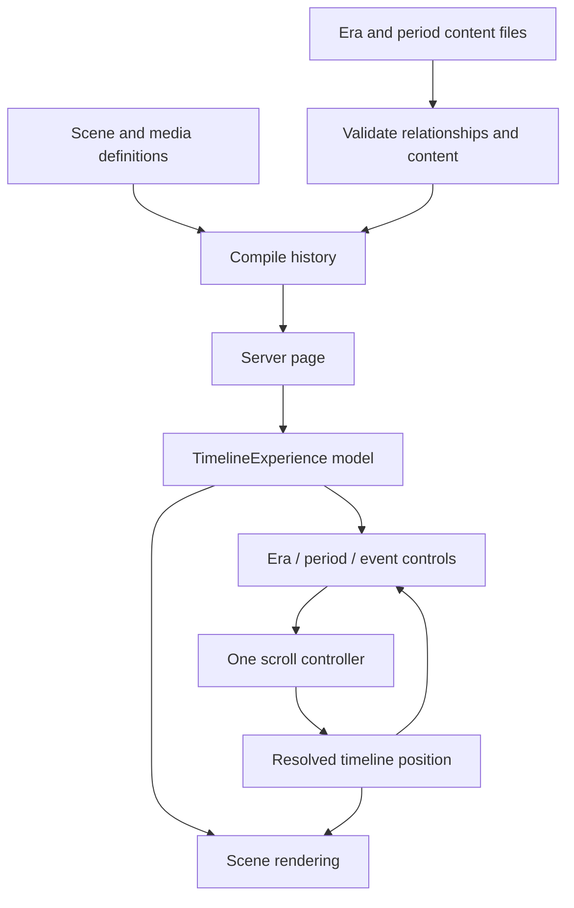

# Project review and next steps

This project is an interactive historical atlas told through a continuous cinematic timeline.
Its strongest existing decision is separating historical records, scene definitions, React rendering,
and GSAP animation. Keep those boundaries as the narrative grows.

## What is implemented

There are eight planned eras, four playable events (including the prehistoric scaffold), an opening
cinematic, layered prehistoric imagery/fact panels, three later prototype scenes, and reduced-motion
handling. Most periods are empty. There is no database, CMS, authentication, or researched source
catalog. The prehistoric scaffold already displays archaeological claims despite its placeholder
status; those claims and the three later summaries still need citations. This review did not verify
their historical accuracy or image rights.

The new compilation boundary runs on the server, before the experience renders. It validates typed
content, resolves presentation, and derives events, navigation, points, and scenes together. The
client receives that model instead of importing and assembling the historical dataset itself.

## Adding content now

1. Add an event to its era/period file using `HistoricalEvent`. Use stable IDs and explicit dates.
2. Add sources and reference their IDs in citations and interpretation notes. Mark an event
   `researched` only after editorial review; having a source is necessary but does not prove accuracy.
3. Leave `visualReference` absent to use the default gradient-and-text scene. For a bespoke scene,
   register its visual ID in `scene-presentations.ts`. An explicit unresolved visual remains an error.
4. Give event media IDs, alternative text, and rights/credit metadata. Reference those IDs from scene
   assets. Put files under `public/assets`; local scene asset existence is checked by the audit script.
5. Run `npm run check`, then `npm run build`. Preview the scene, reverse scroll, and navigate to it.
   There is no separate array of navigation buttons or event indexes to update.

`npm run validate:content` reports editorial gaps without preventing prototype development. Invalid
relationships, dates, and scene bindings fail. `npm run validate:content -- --strict` also fails on
warnings, making it suitable as a future publication gate. The current data intentionally fails that
strict gate. These scripts run during development checks, not in the visitor's browser. The compiler
also runs when Next renders/builds the page, but filesystem auditing is CLI-only.

The validator checks semantic constraints on TypeScript-authored records. It is not a parser for
untrusted CMS JSON. Add runtime schema parsing at that ingestion boundary if external data arrives.

## Recommended implementation order

| Priority | Work                                                      | Why                                                                                                                                                |
| -------- | --------------------------------------------------------- | -------------------------------------------------------------------------------------------------------------------------------------------------- |
| 1        | Complete one researched period end to end                 | Establish the editorial pattern before multiplying content                                                                                         |
| 2        | Sources/credits reader and accessible reading mode        | Make evidence inspectable and the narrative usable without cinematic motion                                                                        |
| 3        | Canonical asset catalog, including opening media          | Paths and opening images are still partly embedded in JSX; rights tracking should cover all assets                                                 |
| 4        | Define deep-time reference epoch                          | Current `years-ago` sorting uses a synthetic ordinal, not an explicit reference year; mixed near-calendar comparisons need a documented convention |
| 5        | Chapter routes and event URL links                        | Enable sharing and loading only the chapter being explored                                                                                         |
| 6        | Weighted scroll geometry                                  | Scene `duration` is currently metadata; navigation and resolution still distribute events evenly                                                   |
| 7        | Lazy media and bounded scene mounting                     | Every scene currently mounts; that will become costly with hundreds of events                                                                      |
| 8        | Search, category/region filters, related-event navigation | Build these over stable event IDs and compiled content                                                                                             |
| 9        | Map and playback adapters                                 | Existing map/video/image-sequence types do not yet implement complete interactive maps or scrubbed playback                                        |
| 10       | CMS adapter when authoring needs it                       | Keep the same compiler contract; add schema parsing and publication workflow before switching data sources                                         |

No database is required to author and ship a static researched narrative. Introduce persistence when
there is a concrete need such as multi-editor drafts or account-synced reading progress. Avoid adding
multiple visualization frameworks before an actual scene needs them.

## Remaining architectural limits

- The single long scroll section and global stylesheet need chapter-level performance and layout
  work before the full historical corpus is added.
- Site marker labels and percentages remain in the prehistoric renderer. Move geography to an
  authored dataset and keep visual placement separate when replacing the illustrative map.
- The compiler still sends rich event records to the client; chapter slicing and a lean display DTO
  should precede large datasets. It is not a database repository or API endpoint.
- Opening animation configuration has its own contract and is not covered by historical validation.
- A meaningful browser regression suite should cover handoff, reverse scroll, restored scroll
  positions, keyboard navigation, reduced motion, and narrow screens. Unit tests cannot prove these.
